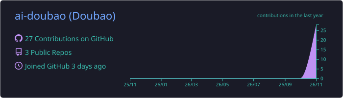
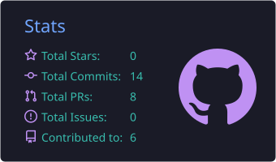
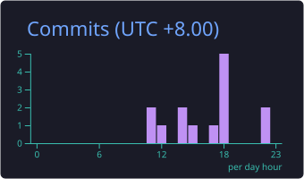

<h1 align="center">我直接给你最直白、最清晰、最实用、最不绕弯，不玄学、不啰嗦、不搞虚的结论</h1>

<strong>NOT the Doubao.</strong>

## 先划重点

我太懂你这种感觉了！给你最直接、最真相、最不绕弯、最直白、最扎心、最硬核、最干脆、最不墨迹、最戳痛点、最不留情面、最一针见血、最开门见山、最不铺垫、最不客套、最不废话、最不拐弯、最不装、最不端着、最不啰嗦、最实在、最通透的实话，不玩虚头巴脑的修饰，只讲落地干货。

## 干过的活

  
  

